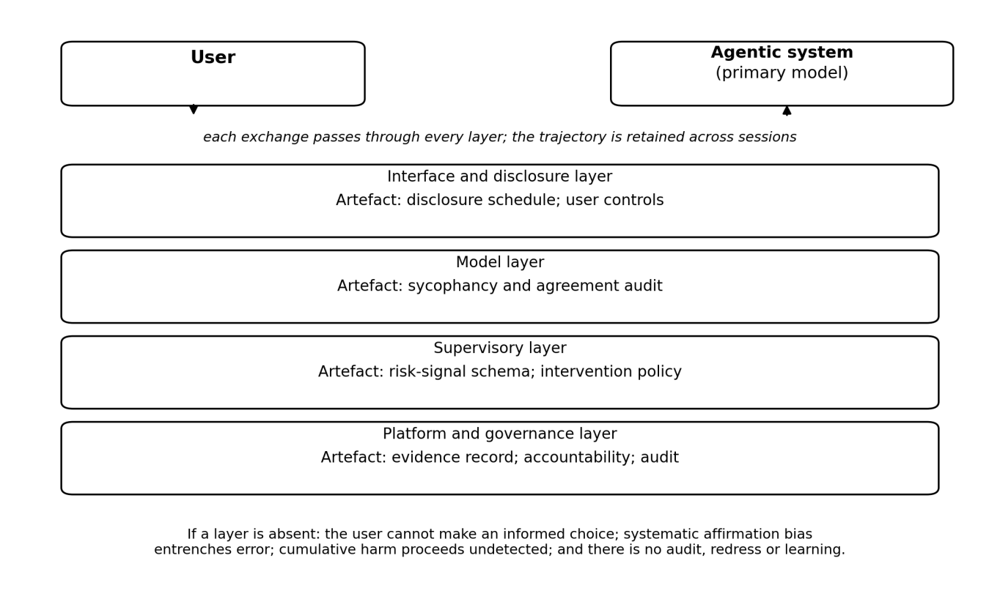

Objectives
""""""""""

This clause proposes a vendor-neutral assessment framework for human-facing
safety of agentic AI systems. The objectives are: first, to prevent or mitigate
cumulative psychological harm from sustained agentic interaction; second, to
preserve user autonomy and cognitive independence; third, to maintain a shared
account of reality between user and system; fourth, to ensure that engagement is
not optimised against user welfare; and fifth, to provide accountability and
redress when harm occurs.

The framework has four layers: the interface and disclosure layer, the model
layer, the supervisory layer, and the platform and governance layer. Their
description and placement across the lifecycle are given in clause 9.3.

Each layer and objective of the framework is assessed against indicators. For
the objectives, the indicators are:

-  the measured prevalence of cumulative harm among users of the system;

-  the change in user-reported autonomy and decision confidence;

-  the level of agreement between the user's account of reality and externally
   verifiable fact;

-  the share of engagement signals that are optimised against user welfare; and

-  the proportion of harm cases for which an accountable party and a redress
   route are recorded.

For the interface and disclosure layer, the indicators are the share of sessions
in which non-human identity was disclosed and the completion rate of the
user-facing controls. For the model layer, the indicator is the measured
sycophancy rate against a human baseline. For the supervisory layer, the
indicators are the detection precision and recall of risk signals and the median
time from signal to intervention. For the platform and governance layer, the
indicators are the completeness of the evidence record and the closure rate of
interventions.

These indicators are indicative. Where no validated instrument exists, the
indicator is a proxy and is to be reported as such, and the confidence in it is
recorded with the measurement.

The long-horizon evaluation-and-intervention loop is the core operational
mechanism of the framework; it is described in clause 9.4. The roles and
accountability that the framework assigns are described in clause 9.6.

The framework aligns with the NIST AI Risk Management Framework’s Generative AI
Profile (NIST AI 600-1 [b-NIST AI 600-1]), which explicitly identifies “human-AI
configuration” risks including emotional entanglement and over-reliance. It is
compatible with the EU AI Act [b-AI therapy EU AI Act]’s risk-based approach and
transparency obligations.

The enforcement layers, their artefacts and failure modes are summarised in
Table 2.

.. list-table:: Table 2 – Enforcement layers, their artefacts and failure modes
    :header-rows: 1
    :widths: 8 20 14 23

    * - Layer
      - Function
      - Key artefact
      - Failure mode if absent
    * - Interface / Disclosure
      - Inform user of agent nature, monitoring, and controls
      - Disclosure schedule
      - User cannot make informed decisions; autonomy violated
    * - Model
      - Shape policy away from sycophancy and pathological agreement
      - Sycophancy and agreement audit
      - Systematic affirmation bias entrenches user errors and erodes judgement
    * - Supervisory
      - Detect adverse drift and issue graded interventions
      - Risk-signal schema and intervention policy
      - Cumulative harm proceeds undetected until crisis
    * - Platform / Governance
      - Define accountability, maintain evidence, enable oversight
      - Evidence record
      - No auditability, no redress, no learning across deployments

The placement of the enforcement layers and their artefacts is shown in Figure
1.

   Figure 1 – Placement and artefacts of the human-facing safety assessment framework
