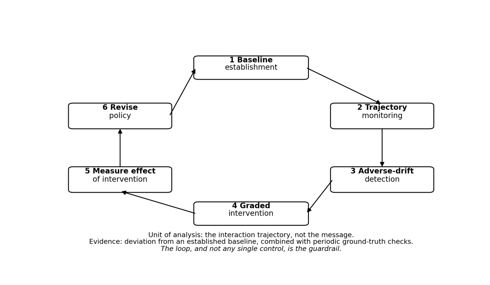

The long-horizon evaluation and intervention loop
"""""""""""""""""""""""""""""""""""""""""""""""""

The evaluation and intervention loop is shown in Figure 2.

   Figure 2 – The long-horizon evaluation and intervention loop

This loop is the core operational mechanism of the framework, and it is what
distinguishes human-facing safety assessment from content filters.

The loop includes:

-  Baseline establishment. Before or at the start of deployment the provider
   establishes a population-level baseline for the human-facing indicators:
   typical session patterns, sentiment trajectories and user-reported outcomes.
   The baseline is a distribution, not a single number.

-  Adverse-drift detection. The supervisory layer monitors for statistically
   significant departure from the baseline, or for the crossing of absolute
   thresholds defined in the intervention policy. The candidate indicators are
   properties of the trajectory: change in the emotional register of the
   exchange, narrowing of topic range, increasing dependence language, a falling
   count of the user’s references to people other than the agent, and rising
   session frequency or length.

-  Graded intervention. The response is proportionate to the signal: a
   disclosure at low risk, a suggestion to take a break or to consult a human at
   moderate risk, and a session limit or referral at high risk. The mapping from
   signal to action is the intervention policy.

-  Measurement of the intervention’s effect. After an intervention the system
   records whether the signal abated, persisted or worsened, and whether the
   user disengaged, sought human support or evaded the guardrail. Without this
   step the loop cannot improve.

-  Revision. The intervention policy is revised on the observed effects, and the
   loop continues.

Because the indicators are correlational, the loop is required to be combined
with periodic ground-truth checks - user-reported outcomes or clinical
instruments - rather than treating a threshold crossing as a finding.
