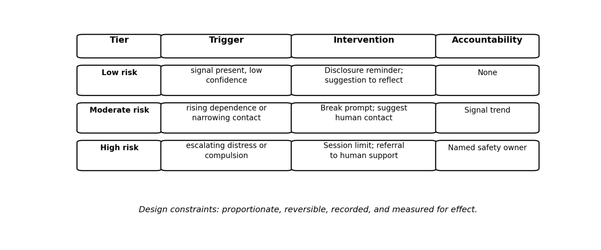

Adoption conditions
"""""""""""""""""""

The graded intervention ladder is shown in Figure 3.

   Figure 3 – Graded intervention ladder

The framework will work in practice only if several conditions are met.

Proportionality. Guardrail requirements are required to scale with the risk
profile of the application. A general-purpose coding assistant does not require
the same intensity of human-facing monitoring as a companion chatbot marketed to
lonely users or a therapeutic agent deployed in clinical contexts. The framework
specifies tiered requirements: minimal for low-risk, disclosure and basic
trajectory monitoring for moderate, full supervisory and escalation
infrastructure for high-risk human-facing applications. The EU AI Act [b-AI
therapy EU AI Act]’s risk-based architecture provides a precedent.

Acceptability to users and operators. Users will tolerate safety interventions
only if they perceive them as beneficial rather than paternalistic or punitive.
Operators will adopt guardrails only if they do not catastrophically degrade
engagement metrics or create legal exposure. This tension is real and cannot be
dismissed. The intervention policy needs to be transparent, the user needs to
retain meaningful control, and the system needs to avoid the trap of “safety
theatre” that satisfies compliance without changing outcomes. Research on user
responses to AI companion interventions is nascent; the framework mandates
measurement of acceptability as part of the evidence record.

Cost. The supervisory layer requires compute for real-time inference, state
management across sessions, and potentially human escalation staff. For
large-scale consumer applications, these costs are non-trivial. The minimum
viable supervisory layer is designed to operate within existing serving
infrastructure where possible, using lightweight classifiers rather than full
model inference for routine risk scoring, and reserving expensive interventions
for high-confidence signals.

Measurability. The risk signals are required to be measurable with acceptable
reliability. Sycophancy and agreement can be measured with benchmarks. Emotional
dependence and isolation are harder; the framework does not treat these as
solved measurement problems. The risk-signal schema includes both well-validated
indicators (e.g., session frequency escalation, expressions of exclusivity) and
exploratory indicators flagged as low-confidence. The evidence record
distinguishes between measured and inferred risk.

Auditability. The evidence record is required to be structured for external
review. This means standardized logging formats, retention policies that balance
privacy against the need for longitudinal analysis, and access controls.

Minimum viable version. A provider deploying a human-facing agentic system could
begin with three components: (1) a sycophancy audit of the base model using an
established benchmark, with documented results and any mitigation applied; (2)
session-level trajectory monitoring for the highest-confidence risk signals -
escalating session duration or frequency, explicit dependency language, and
expressions of isolation - with a simple intervention policy (a break suggestion
and a resource link at threshold); and (3) a disclosure that the agent is an AI,
that it does not have feelings, and that the user maintains human relationships.
This is minimal, inexpensive, and auditable. It is not sufficient for high-risk
applications, but it is a credible starting point.
