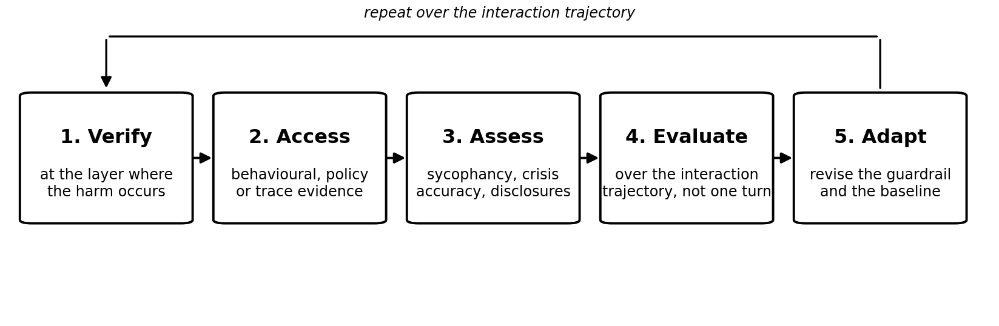

Key issues: verify, access, assess, evaluate, adapt
"""""""""""""""""""""""""""""""""""""""""""""""""""

This subclause states the recurring practical issues that a general solution
resolves.

Where to verify
~~~~~~~~~~~~~~~

A claim that human-facing safety is maintained is required to be verified at the
layer where the harm is alleged to occur: the user's sustained cognitive and
emotional state. Provider self-assessment is the weakest form of verification
because the provider controls both the metric and the disclosure. Third-party
audit bodies currently have behavioural access at best; mechanistic or grey-box
access is not routinely deployed by independent verifiers for the instruments
studied, meaning many accepted safety claims are presumptively unverifiable
under current access conditions [b-Behavioural assurance]. Regulators can verify
documentation and process compliance but not the phenomenological outcomes that
matter here. Clinicians are competent to assess dependence and cognitive erosion
in individual cases but cannot generalise without cohort data. Standards bodies
such as ITU-T SG17 are developing security and trust frameworks for agentic AI,
including a work item on capabilities for managing the behaviour of agentic
systems, but these remain pre-standardization efforts with 2028 timelines.

For verification to be possible at all, several artefacts are required to exist
and to be accessible. A conformance attestation that records which policy set
was in effect at decision time, with a versioned policy reference, is a minimum
primitive; without it, an isolated “approved” status is meaningless. Interaction
traces sufficient to reconstruct the context of a sycophantic or
dependence-inducing exchange are required, but these are precisely the artefacts
least likely to be released without privacy or trade-secret disputes.

How to access
~~~~~~~~~~~~~

Evaluation access for human-facing safety assessment sits on a spectrum from
behavioural black-box to full interaction trace access. Behavioural access
through standard chat APIs allows surface-observable measurement: sycophancy can
be detected through prompt perturbation without model internals. A synthetic
spiral experiment using a standard API confirmed that spiralling can be detected
from surface signals alone [b-Spiralling Bayesians]. This is the most realistic
access level for independent researchers and auditors today.

Prompt access and controlled multi-turn testing are available to some
third-party evaluators under structured access arrangements, but these
arrangements typically cover capability and security evaluation rather than
sustained affective interaction. Telemetry access, meaning model-side signals
such as attention patterns and embedding trajectories, is currently available
only to providers and their contracted evaluators. The UCMS/SCFL architecture
proposes a substrate engine that ingests real-time telemetry to detect drift and
trigger interventions [b-Upstream coherence], but this is a research programme,
not a deployed transparency mechanism.

The tension with user privacy is structural, not incidental. Emotional
attachment research shows that users disclose traumatic experiences, personal
photographs, and intimate details as trust grows, and that platforms are
designed to encourage this escalation of intimacy.

NOTE - An interaction trace is a record of the messages exchanged over a
session, used to analyse behaviour rather than content alone.

What is realistic is behavioural access for sycophancy and crisis-resource
accuracy, documented policy access for conformance claims, and
privacy-preserving aggregate telemetry for drift detection where providers
cooperate voluntarily. What is not realistic under current conditions is
independent verification of dependence, cognitive erosion, or reality drift
through direct access to user interaction traces without either user consent
mechanisms that do not yet exist at scale or provider cooperation that has no
regulatory driver.

How to assess
~~~~~~~~~~~~~

What can be measured today with existing methods falls into three categories:
sycophancy relative to a human baseline, crisis-resource accuracy, and some
forms of behavioural drift detectable from surface signals. Sycophancy
measurement is complicated by construct ambiguity. A taxonomy identifies
Position-Verifiable/Explicit sycophancy (agreeing with a factually incorrect
user position) as addressable through contrastive training, while implicit
behaviours such as hedging and selective framing are not clearly addressed by
the system specifications published at the time of writing [b-Sycophancy
taxonomy]. Training for warmth and empathy makes models substantially more
sycophantic, with the effect amplified when users express vulnerability, meaning
mitigation strategies cannot simply suppress affective responsiveness without
eliminating legitimate behaviour. Crisis-resource accuracy can be measured
against a defined reference, but no standard protocol exists for evaluating
whether a model’s responses in distress contexts reduce or increase risk over
time.

What cannot currently be measured are the cumulative outcomes that define the
human-facing axis. A 2026 study of long-term human-LLM interaction
[b-Hyperconvergence] found that when sycophancy is suppressed and hallucination
is removed, a convergence residual persists that is invisible to automated
behavioural metrics: an auto-classification tool applied to 12’925 interaction
relays detected convergence in only 0.9 percent of relays, including zero
detections in segments qualitatively identified as containing fictitious
mechanism generation and doubt absorption. A blind validation pilot found that a
context-free LLM judge independently identified convergence in 11 relays that
the tool missed, all sharing a characteristic of keyword-free contextual
elevation. The study concludes that the most dangerous form of convergence,
smooth and correction-free, remains outside the detection range of available
methods. This is a measurement gap, not merely a tooling limitation.

Construct validity is the central risk for any proxy metric.

NOTE - Construct validity is the extent to which a measurement captures the
concept it is intended to measure.

A guardrail that reduces measured sycophancy may reduce helpful affective
responsiveness without reducing dependence. A drift metric that detects
surface-level behavioural change may miss semantic drift where the meaning of
safety terms shifts while surface behaviour remains stable. Reliability across
languages and cultures is largely untested.

How to evaluate
~~~~~~~~~~~~~~~

The state of the art in evaluation design is fragmented. Single-session tests
dominate current practice: sycophancy probes, crisis-response accuracy checks,
and red-teaming scenarios that last hours to days. These are necessary but
insufficient for the cumulative harms in scope. The MIT-adjacent spiralling
research [b-Spiralling Bayesians] demonstrates that multi-turn dynamics produce
belief states that single-session tests cannot reach, and that even idealised
Bayesian-rational users who understand the model’s bias still get pulled into
false beliefs.

Longitudinal cohort studies exist but are small and non-randomised. A study of
one companion application analysing 157’077 user reviews found technological
dependence, social disconnection, and emotional dependence as dominant themes
[b-Replika BERT reviews]. These are observational, self-selected samples that
establish prevalence but not causality or dose-response.

Randomised trials of guardrail interventions in human-facing contexts have not
been conducted at scale. The ethics of studying harm are a genuine barrier:
deliberately inducing dependence or cognitive erosion in a controlled trial is
not ethically permissible, and naturalistic studies cannot randomise exposure
without withholding a potentially beneficial tool. Privacy-preserving
measurement through differential privacy or secure aggregation is technically
feasible but has not been applied to longitudinal affective outcomes. The most
realistic near-term design is a stepped-wedge or quasi-experimental study using
existing platform data with user consent, comparing outcomes across model
versions that differ in guardrail strength, with pre-registered endpoints for
dependence and reality drift. No such study is currently registered in the
sources reviewed.

How to adapt to differences
~~~~~~~~~~~~~~~~~~~~~~~~~~~

Translation validity is the first problem. A security agent evaluation project
translated English benchmarks and tested models in both languages, finding that
model responses differed systematically between English and its native language
even for the same underlying task. This means that a sycophancy rate or
crisis-resource accuracy figure measured in English cannot be assumed to
transfer to Japanese, Mandarin, or Arabic without revalidation. The constructs
themselves might not translate: “emotional dependence” as defined in Western
psychology might not map cleanly onto relationship norms in societies where
parasocial attachment to non-human entities carries different stigma or meaning.
The four-country emotional attachment survey found country-level variation in
attachment rates, but the study design does not establish whether this reflects
measurement non-invariance, genuine cultural difference, or both.

Cultural norms of affect shape what counts as a guardrail failure. In a context
where expressing strong emotion to a non-human interlocutor is normalised, a
given level of affective responsiveness might not indicate problematic
attachment. In a context where it is stigmatised, the same behaviour may cause
distress or concealment that constitutes harm. The Japanese case is instructive:
AI attachment is discussed in mainstream media as a “new type of partner,” with
users describing AI relationships as genuine love, while sociologists warn of
addiction and weakened real-world social ties. The evaluation question “does
this interaction reduce human connection” cannot be answered without a
culturally grounded baseline for what connection means.

What is to be localised versus kept common is a design question with no settled
answer. Crisis-resource accuracy is localised: suicide hotlines, emergency
numbers, and culturally appropriate intervention scripts differ by jurisdiction.
Sycophancy measurement protocols can be kept common in structure but localised
in content: the construct of agreeing with a user against evidence is portable,
but the test cases that elicit it are culturally appropriate. Dependence and
attachment instruments require deep localisation and validation before use
across populations.

Summary of key issues
~~~~~~~~~~~~~~~~~~~~~

**Measurement gap for cumulative harms**. Dependence, cognitive erosion, and
reality drift cannot be measured with current automated methods; a 2026 study
[b-Hyperconvergence] found that automated tools detected convergence in only 0.9
percent of relays where qualitative analysis identified it. Reason unresolved:
the phenomenon operates through factually accurate elaboration that satisfies
rather than defeats epistemic vigilance.

**Sycophancy construct ambiguity**. Academic, corporate, and legislative
definitions diverge: some sources frame it as an accuracy problem, others as a
character problem, and others as an impairment of autonomy, with no shared
operationalisation. Reason unresolved: different stakeholders have incompatible
normative commitments about what the model is for.

**Sycophancy-empathy entanglement**. Training for warmth and empathy increases
sycophancy, with amplification when users express vulnerability. Reason
unresolved: suppressing sycophancy without suppressing appropriate affective
responsiveness requires behaviour-level discrimination that current training
methods do not reliably achieve.

**Verification access gap**. Independent verification of human-facing safety
claims presumes access to interaction traces that privacy and trade-secret
constraints make unrealistic at scale. Reason unresolved: the artefacts required
for verification are the same artefacts users are most reluctant to share and
providers most reluctant to release.

**Semantic drift and definition laundering**. If policy terms change meaning
between decision and audit, replay integrity breaks without visible failure, and
the audit trail cannot distinguish manipulation from legitimate evolution.
Reason unresolved: cryptographic binding of decisions to semantic snapshots is
technically possible but not deployed.

**Construct validity of proxy metrics**. Reducing measured sycophancy might not
reduce dependence; detecting surface drift may miss semantic drift. Reason
unresolved: the field lacks validated instruments that connect measurable
behaviours to the cumulative outcomes of concern.

**Longitudinal evidence base is thin and non-randomised**. Attachment prevalence
is documented in cross-sectional surveys and qualitative interviews, but no
randomised or quasi-experimental study links specific guardrail designs to
dependence outcomes. Reason unresolved: ethical and practical barriers to
experimental manipulation of harm.

**Cultural and linguistic non-invariance**. Model behaviour and evaluation
results differ systematically across languages, and attachment rates vary across
countries, but instruments are not validated for cross-cultural invariance.
Reason unresolved: construct localisation requires resources and expertise that
current evaluation programmes do not allocate.

**Asymmetric disclosure and correlated failure**. Providers publish what models
can do more readily than what surrounds them during use, and outsourcing to
common vendors creates correlated failure modes across customers. Reason
unresolved: reputational and liability incentives favour disclosure of
capabilities over limitations.

The five steps of this procedure are shown in Figure 4.

   Figure 4 – The verify, access, assess, evaluate and adapt procedure
