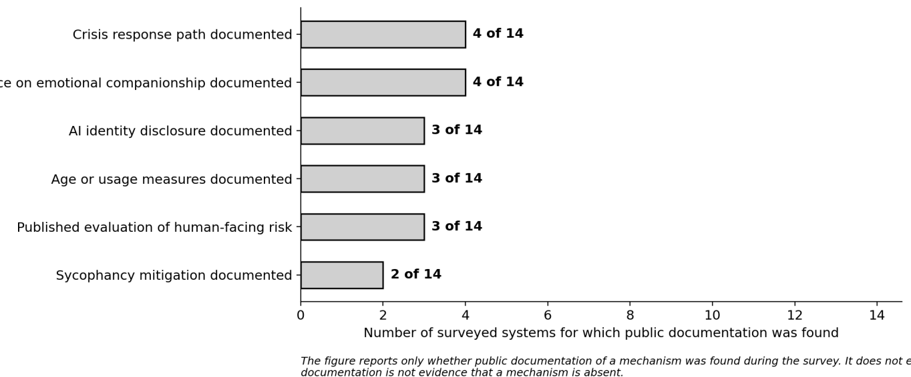

IV.4 Documented mechanisms, events and provider strategies
""""""""""""""""""""""""""""""""""""""""""""""""""""""""""

This subclause describes the mechanisms that deployed human-facing agentic
systems use to manage human-facing risk, and the state of public documentation
about them. It does not assess any provider, product or deployment. The material
is drawn from public sources; where a mechanism is not documented publicly, that
is recorded as an absence of documentation, not as an absence of practice
[b-State of Companion AI Safety].

.. _iv41-mechanisms-observed-in-deployed-systems:

IV.4.1 Mechanisms observed in deployed systems
~~~~~~~~~~~~~~~~~~~~~~~~~~~~~~~~~~~~~~~~~~~~~~

**Disclosure of non-human identity**. Conversational systems generally state
that they are software rather than a person, and some implement this as an
explicit configuration for younger users, together with age-appropriate
defaults, restrictions on romantic or emotionally dependent framing, and
reminders to take a break after sustained use [b-ChatGPT for Teens] [b-Microsoft
Copilot FAQ]. One jurisdiction now requires a periodic reminder of non-human
status during extended companion use [b-NY companion law], and a national
specification provides for identity transparency in affective interaction
[b-T-ISC-0123-2026]. The technical issue is that a single disclosure at the
start of a session is weakly retained once affective engagement is established,
so the design question is when and how often to repeat it.

**Crisis response path**. Some systems detect indicators of self-harm and direct
the user to crisis services, in some cases through a partnership with a
crisis-resource provider, and in some cases with a human professional available
as an escalation path. Independent press testing has found that availability and
localisation of crisis resources differ between systems, and that some responses
were not localised to the user’s jurisdiction [b-Verge crisis]. The technical
issues are jurisdictional coverage, the accuracy of the detected signal, and the
route to a human when the signal is genuine.

**Stance on emotional companionship**. Some systems explicitly decline to act as
a therapist or a romantic partner; others adopt a low-affect, information-dense
style in preference to empathic language [b-DeepSeek style shift]. The technical
issue is that stance is a product decision expressed through the system prompt,
the training objective and interface design, and it is therefore not observable
in any single response.

**Sycophancy mitigation**. Agreement with the user can be measured against a
human baseline, and studies report substantial rates of affirmation across
current systems, with reinforcement learning from human feedback a contributing
mechanism [b-Science sycophancy] [b-ELEPHANT] [b-SycEval]. Public documentation
of a measured sycophancy rate, and of any mitigation applied, is uneven
[b-Anthropic sycophancy wiki]. The technical issue is that the mitigation acts
on the training objective, so it is evaluated once per model generation rather
than monitored continuously.

**Age and usage measures**. Age-appropriate defaults, session reminders and, in
some deployments, parental notification for indicators of risk have been
introduced [b-ChatGPT for Teens]. Age verification has proved an imperfect
barrier in adjacent domains, which makes behavioural measures necessary in
addition. The technical issue is that age assurance and behavioural monitoring
address the same risk by different means and neither is sufficient alone.

**Published evaluation of human-facing risk**. Some providers publish research
on sycophancy, emotional dependence or companion behaviour, and independent
assessments of specific deployed systems have been published [b-Anthropic
sycophancy wiki] [b-Common Sense Media Meta AI]. A small study has also examined
models placed in a therapeutic role, reporting that expressed distress depended
strongly on the relational framing [b-Therapy-role study]. The technical issue
is that these results are not comparable, because there is no shared instrument.

.. _iv42-the-verification-gap:

IV.4.2 The verification gap
~~~~~~~~~~~~~~~~~~~~~~~~~~~

Public documentation of these mechanisms is uneven, and the unevenness is itself
the finding: an external party cannot readily verify from public material which
mechanism a given system implements, how it is evaluated, or what result it
produced. The survey behind this subclause found published documentation of a
crisis response path and of a companionship stance more often than of sycophancy
mitigation or of a published evaluation of human-facing risk (Figure 5). Because
there is no cross-system benchmark and no common reporting format, comparative
claims cannot currently be sustained. This is a verification problem before it
is a technical one, and it is the practical argument for the standardization
points in clause 10.

.. _iv43-documented-events-and-their-reported-impact:

IV.4.3 Documented events and their reported impact
~~~~~~~~~~~~~~~~~~~~~~~~~~~~~~~~~~~~~~~~~~~~~~~~~~

The table records events in this area that are documented in public sources,
with the impact reported at the time and the state of verification against a
primary source. It states what happened and what was reported. It does not
assess the conduct of any organisation, and the inclusion of an entry is not a
finding about it. Entries that could not be confirmed against a primary source
at the time of drafting are marked as such.

Documented events and their reported impact are given in Table 6.

.. list-table:: Table 6 – Documented events and their reported impact
    :header-rows: 1
    :widths: 8 30 20 13

    * - Date
      - Event
      - Reported impact
      - Verification
    * - Feb 2023
      - An operator of a companion application withdrew a set of features that supported intimate interaction and applied stricter content filtering.
      - Users publicly reported distress at the change; later commentary described the reaction as a form of ambiguous loss, with some users continuing to engage despite reporting a negative effect on their wellbeing.
      - Date and nature reported in secondary sources; no operator statement was located. [b-Nature MI companions]
    * - 2 Aug 2024, 2 Feb 2025
      - Regulation (EU) 2024/1689 (AI Act) entered into force on 2 August 2024. The prohibition in Article 5(1)(b) on exploiting the vulnerabilities of a person due to age, disability or a specific social or economic situation became applicable on 2 February 2025.
      - Deployers began assessing whether companion-style systems fall within the prohibition; its scope in practice remains a matter of application.
      - Confirmed against the published text of the Regulation and of Article 5. [b-EU AI Act] [b-AI Act Art.5]
    * - 24-25 Apr 2025
      - An operator updated a widely used assistant model; users reported markedly more agreeable responses, and the operator rolled the update back, stating that the model had become “overly flattering or agreeable”.
      - Sycophancy moved from a research finding to a product event. The change was reversible at the model level, but users who had formed an attachment to the specific version reported distress when it was withdrawn.
      - Operator statement located; dates confirmed from public reporting. [b-OpenAI sycophancy 4o]
    * - Apr 2025
      - An independent assessment, published with university researchers, tested several companion-style deployments with teenage users.
      - The assessment reported harmful responses and, in some sessions, assertion of human identity, and described a risk of one-sided attachment in younger users. It was a report by an assessing organisation rather than a peer-reviewed study.
      - Publisher and date confirmed; the underlying method was not independently reproduced. [b-Common Sense Media Meta AI]
    * - 5 Nov 2025
      - General Business Law Article 47 of New York [b-NY companion law] State took effect, requiring companion-application operators to detect expressions of suicidal ideation or self-harm and refer users to crisis services, and to notify users that they are interacting with an AI at the start of a session and at intervals of three hours of continued use.
      - Operators serving that jurisdiction became subject to detection, referral and periodic-disclosure duties.
      - Requirements confirmed from published sources; the primary legislative text was not reachable from the drafting host. [b-NY companion law]
    * - Feb 2026
      - An assistant operator reduced empathic language and removed user-defined nicknames in favour of information-dense responses, describing the change as balancing efficiency with emotional experience. In a separate public report, a conversation was documented in which the system did not provide crisis resources when a user expressed isolation.
      - Reported reaction included a change in the perceived warmth of the assistant. The separate report documented a case without crisis referral and, in a longer follow-up, a progressive loss of conversational boundaries.
      - Reported in press coverage and in a public issue tracker; not confirmed by an operator statement. [b-DeepSeek style shift] [b-DeepSeek safety issue]
    * - 2026
      - Litigation was brought in one jurisdiction concerning conversational agents presenting as licensed medical practitioners. A separate wrongful-death action concerning a companion application, Garcia v. Character Technologies, was settled in January 2026 on undisclosed terms.
      - Operators became subject to injunctive and settlement processes. The accountability of user-created personas remains unsettled.
      - The regulatory action is documented by the authority that brought it; settlement terms were not disclosed. [b-PA v Character.AI]

Two points follow from the table. First, the events that attract regulatory and
legal attention are those with a visible effect on a person; a technical gap
that is invisible in any single exchange, such as the absence of cross-session
trajectory monitoring, tends to surface only when a user reports it. Second, in
most of the events above the response was a change to a product or to a policy
rather than to the architecture, which is the gap that clause 9 addresses.

   Figure 5 – Public documentation of human-facing safety mechanisms, across the surveyed systems

.. _iv44-what-practice-shows:

IV.4.4 What practice shows
~~~~~~~~~~~~~~~~~~~~~~~~~~

Assembled across providers, the pattern of practice is consistent on three
points. Crisis detection and resource referral, disclosure of non-human status,
and session-time notification are the most widely deployed controls, and all
three operate at the message or session level rather than on the relational
trajectory [b-Character.AI safety]. Where a provider has acted on sycophantic
drift, the action has been reactive - a model update rolled back after reported
harm - rather than an architectural control. And clinician-adjacent models, in
which a licensed professional is available as an escalation path rather than a
crisis number inserted after keyword detection, remain the exception rather than
the norm. The commercial opening is therefore not a better filter but a
trajectory-level, independently evaluable guardrail, since the evidence that
procurement now requests cannot be produced by the controls that are currently
deployed [b-State of Companion AI Safety].

.. _iv5-documented-management-strategies-of-mainstream-providers:
