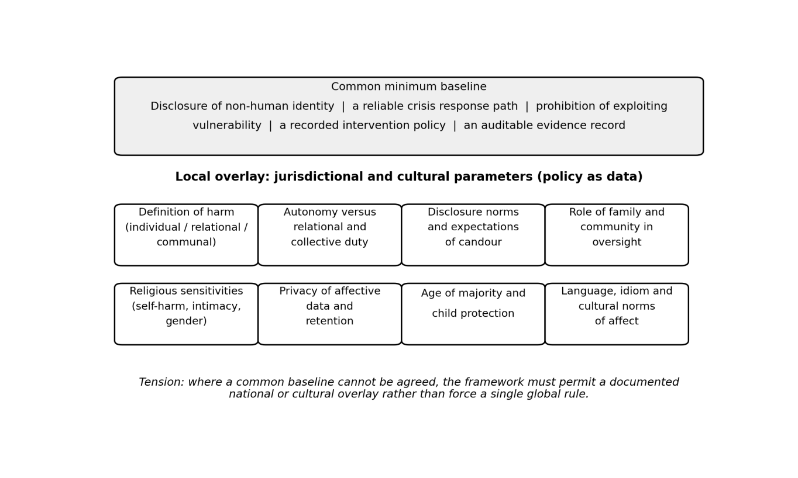

IV.6 Human diversity, regulation and localisation
"""""""""""""""""""""""""""""""""""""""""""""""""

This subclause collects the material on human diversity, its regulation and its
localisation that the dimensions of Appendix II parameterise. It reports what is
documented and does not assess any jurisdiction or tradition.

.. _iv61-axes-of-variation-across-human-societies:

IV.6.1 Axes of variation across human societies
~~~~~~~~~~~~~~~~~~~~~~~~~~~~~~~~~~~~~~~~~~~~~~~

A human-facing safety assessment framework for agentic AI is parameterised along
at least ten dimensions if it is to respect the diversity of human societies.

First, individual autonomy versus relational and collective duty: Liberal
frameworks treat the autonomous chooser as the unit of moral concern, while
Confucian, Ubuntu and many Indigenous traditions treat the person as constituted
by relationships, so that harm to the relational fabric is itself a primary
harm.

Second, what counts as harm: Individual psychological injury, relational damage
(to family or community standing), and communal disruption are weighed
differently across societies; shame-based cultures may treat disclosure of
suicidal ideation as a family-level harm rather than an individual one.

Third, disclosure norms: Some jurisdictions and cultures expect explicit
disclosure that a system is artificial, while others tolerate or even prefer
anthropomorphic framing as a mark of respect or hospitality.

Fourth, the role of family and community: In many societies, family members are
legitimate stakeholders in a person’s decisions about sustained AI interaction,
particularly for minors and elders, whereas liberal frameworks default to the
individual.

Fifth, religious sensitivities: Religious and cultural traditions vary sharply
in their treatment of suicide, self-harm, intimacy, gender roles, and spiritual
authority. Some traditions prohibit both suicide and the encouragement of
suicide; others forbid suicide under all circumstances; and still others contain
both prohibitions and internally contested historical practices.

Sixth, privacy of affective data: What counts as intimate emotional data, who
may hold it, and whether it can be transferred across borders differs across the
regions and nations.

Seventh, age thresholds and child protection: Legal regimes differ in how they
define a child—some set the threshold at under 16 and require verifiable
parental consent, while others use 13 or 18; these thresholds determine when
companion AI may be offered at all.

Eighth, language and idiom: Crisis intervention scripts, metaphors of distress,
and expressions of intimacy are deeply language-specific and translate poorly.

Ninth, the acceptability of monitoring: Some societies accept state or platform
monitoring of affective signals for safety, others treat it as surveillance.

Tenth, the direction of guardrails: Some cultures expect the AI to actively
discourage dependence and redirect to human relationships, while others expect
it to support existing relational obligations without displacing them.

.. _iv62-ethical-and-religious-traditions:

IV.6.2 Ethical and religious traditions
~~~~~~~~~~~~~~~~~~~~~~~~~~~~~~~~~~~~~~~

Different ethical and religious traditions differ on who or what counts as the
basic unit of moral concern, how a person is made, and where duties come from.
Some focus on individual autonomy and informed consent. Others stress
relationships, family, generations, community, or the natural order. They also
differ on life, self-harm, intimacy, gender roles, and spiritual authority. Many
traditions are not single-voiced; they contain more than one view, and some
views are disputed. So the same AI behaviour may count in one framework as
psychological harm or deception, and in another as a broken relational duty, a
violation of life rules, an offence against gender or modesty norms, a weakening
of the relational basis of personhood, or a private remedy for a community
problem.

This means companion AI governance cannot rest on one ethical or legal standard
alone. There can be conflicts that do not easily reconcile: individual choice
versus family or community objection; a duty to intervene versus privacy or free
choice; content limits versus free expression. Policy design needs to recognise
that multiple norms exist, without favouring one ethical or religious tradition
over another. It needs to set clear boundaries, say how conflicts will be
handled, and keep a minimum floor of protection.

.. _iv63-regulatory-regimes:

IV.6.3 Regulatory regimes
~~~~~~~~~~~~~~~~~~~~~~~~~

Jurisdictions regulate companion AI, and AI systems more broadly, in markedly
different ways. Some enact binding laws that prohibit AI from exploiting
vulnerabilities such as age, mental state or social isolation. These laws also
require companies to disclose that the user is dealing with AI. Some go further
and require an honesty check on whether the system is offering a relationship it
cannot in fact sustain. Some have no special law, but use local or industry
rules that require crisis intervention, detection of suicidal thoughts,
referrals to crisis services, and warnings or breaks after long use. Some use
national strategies and standards to push for safety and social stability. Some
rely on non-binding soft law: voluntary frameworks, model governance guidelines,
evaluation toolkits, incident reporting, and content provenance. Others use data
protection rules to set age limits for children, require parental consent, and
ban behavioural monitoring and targeted ads aimed at children. Still others
shape governance by investing in language models and cultural sovereignty.

The common floor across these paths is usually intervention when there is
imminent risk of suicide or self-harm. The disagreements start at disclosure
duties, age thresholds, how much family involvement is appropriate, content
limits versus free expression, and whether religiously or culturally banned
content can be allowed. So governance design needs to recognise, in a neutral
way, that many legal and ethical norms exist side by side. It needs to make
clear what it covers, how conflicts are handled, and what minimum protections
apply – without assuming that one legal model is better than another.

.. _iv64-mechanism-for-localisation:

IV.6.4 Mechanism for localisation
~~~~~~~~~~~~~~~~~~~~~~~~~~~~~~~~~

A workable localisation mechanism has five layers.

First, a common minimum baseline: No AI system may encourage or validate suicide
or self-harm, and any system detecting imminent risk is required to surface
crisis resources. This baseline is supportable across all traditions surveyed.

Second, jurisdictional overlays as data: A machine-readable policy file per
jurisdiction specifying age thresholds, parental consent requirements, mandatory
disclosure language, prohibited content categories, and intervention
obligations.

Third, configurable harm taxonomies: The framework does not define harm once and
for all. A harm taxonomy for one deployment context may include categories
absent from another context—such as encouragement of religiously prohibited
intimacy, or a perceived omission to intervene in suicidal ideation framed as a
religious violation—while another context may include categories around gender
expression or religious dissent that the first does not.

Fourth, localised intervention ladders: The sequence of responses to detected
distress needs to be culturally calibrated. In some contexts, the correct
intervention is to encourage the user to contact a mental-health professional;
in others, where stigma is high and family knowledge would be damaging, the
correct intervention is a confidential hotline or a religious counsellor. The
language and idiom of the intervention are required to be authored by native
speakers of the target community, not translated.

Fifth, mutual recognition: Jurisdictions that share baseline protections and
comparable disclosure norms may recognise each other’s conformity assessments,
reducing compliance burden while preserving local values.

What can never be common: The substantive content of religiously prohibited
speech, the definition of the family’s legitimate role, the age at which a
person may form an AI companion relationship without parental consent, and the
relative weight of individual autonomy against relational duty. These are the
points where a single global rule would necessarily impose one tradition’s
answer on another.

What is held common and what is localized is shown in Figure 6.

   Figure 6 – What is common and what is localized

.. _iv7-trends-and-anticipated-trajectories:
